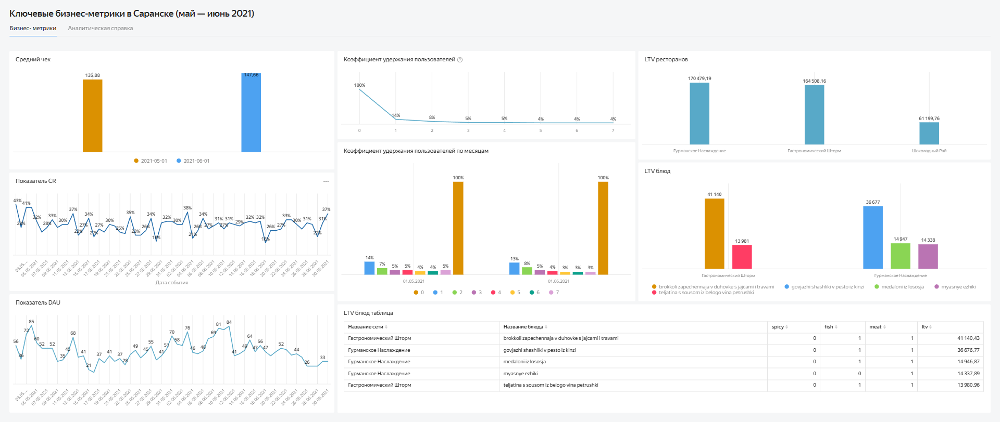

# Алексей Клепцов — Data Analyst

**SQL • Python • Product Analytics • BI • Yandex DataLens**

Аналитик данных с управленческим опытом. Специализируюсь на исследовании данных, продуктовых и бизнес-метриках, визуализации и поиске точек роста с помощью **SQL, Python и BI-инструментов**.

В аналитических проектах стремлюсь пройти полный путь от бизнес-вопроса и подготовки данных до визуализации результатов и конкретных рекомендаций для принятия решений.

Более 15 лет работал в преподавании и управлял проектами. Этот опыт помогает мне структурировать сложные задачи, понятно презентовать результаты анализа и переводить данные на язык бизнеса.

---

## Как со мной связаться
- **Email:** aklepcv@gmail.com  
- **Телефон:** +7 (960) 163-43-70  
- **Telegram:** [@aklepcv](https://t.me/aklepcv)  
- **GitHub:** [aklepcv-analitic](https://github.com/aklepcv-analitic)  

---

## Навыки и инструменты
**SQL**
- CTE
- оконные функции
- JOIN
- агрегирование данных
- построение аналитических витрин

**Python**
- Pandas
- NumPy
- SciPy
- Matplotlib
- Plotly
- Seaborn

**BI и визуализация**
- Yandex DataLens
- Matplotlib
- Plotly
- Excel

**Статистика**
- A/B-тестирование
- проверка статистических гипотез
- исследовательский анализ данных

**Инструменты**
- Git / GitHub
- Jupyter Notebook
- VS Code
- REST API
---

## Проекты в портфолио

# 1. Анализ рынка недвижимости Санкт-Петербурга и Ленинградской области 

## О проекте

Проект посвящён исследованию динамики рынка вторичной недвижимости в Санкт-Петербурге и Ленинградской области. На основе данных о публикациях и продажах квартир проведён анализ сезонности, длительности экспозиции и ценовых метрик для выявления рыночных закономерностей.

## Бизнес-задача

Выявить сезонные паттерны и оптимальные сроки экспозиции объектов для повышения эффективности продаж, а также определить различия в динамике рынка между Санкт-Петербургом и Ленинградской областью.

## Используемый стек

- `SQL` `PostgreSQL`
- `Оконные функции` `CTE`
- `Перцентильная фильтрация`
- `Агрегация данных`

## Что сделано

- Проведена очистка данных более **15 000 объявлений** с фильтрацией аномальных значений по 1-му и 99-му перцентилям (площадь, комнаты, балконы, высота потолков).
- Выполнена сегментация объявлений по длительности экспозиции: до месяца, до трёх месяцев, до полугода, более полугода.
- Рассчитаны средняя стоимость квадратного метра и средняя площадь для каждого сегмента в разрезе регионов.
- Проанализирована помесячная динамика публикаций и продаж.
- Выявлены сезонные пики активности на этапах размещения и заключения сделок.
- Сопоставлена средняя цена квадратного метра при публикации и при продаже для оценки рыночной коррекции.

## Результаты

- Доля объявлений со сроком экспозиции **до месяца** в Санкт-Петербурге значительно выше, чем в Ленинградской области, что свидетельствует о более ликвидном рынке.
- Определены месяцы с наибольшей покупательской активностью — рекомендация для планирования выводов объектов.
- Обнаружены сегменты с аномально длительной экспозицией («более полугода») — зоны для пересмотра ценовой стратегии.
- Подготовлена аналитическая витрина, позволяющая отслеживать ключевые метрики рынка в динамике без повторных выгрузок.

[Открыть SQL запрос](./Анализ%20по%20продажам%20недвижимости.sql)

---

## 2. Продуктовая аналитика сервиса доставки

### Бизнес-задача

Разработать систему мониторинга ключевых продуктовых показателей сервиса доставки и предоставить бизнесу инструмент для оперативного контроля эффективности.

### Что сделал

- подготовил аналитическую витрину;
- рассчитал ключевые продуктовые метрики;
- реализовал мониторинг динамики показателей;
- добавил отслеживание аномальных изменений;
- разработал интерактивный dashboard в Yandex DataLens.

### Основные метрики

- DAU;
- Conversion Rate;
- Retention;
- LTV;
- показатели эффективности ресторанов.

### Результат

На основе проведённого анализа были сформированы рекомендации по корректировке промо-стратегии.

После изменений:

**Conversion Rate достиг 35%**

**Retention 7-го дня достиг 10%**

`SQL` `Product Analytics` `DataLens` `Business Metrics` `Anomaly Detection`

### Dashboard

[Открыть дашборд в Yandex DataLens](https://datalens.yandex/go5ytr673zqs0)

---

## 3. Исследование рынка общественного питания Москвы

### Бизнес-задача

На основе данных московского рынка общественного питания определить перспективный формат, ценовой сегмент и локацию для открытия нового заведения.

Исследование выполнено как аналитический проект для потенциального инвестора.

### Данные

Проанализированы данные по **8 406 заведениям Москвы**.

### Что сделал

- загрузил и объединил данные из нескольких источников;
- обработал пропуски, дубликаты и выбросы;
- выполнил нормализацию и преобразование типов данных;
- провёл исследовательский анализ данных;
- сегментировал рынок по типу заведения, кухне, ценовому сегменту и административным округам;
- разделил заведения на сетевые и несетевые;
- исследовал распределение рейтингов и цен;
- проверил гипотезы о связи характеристик заведения, расположения и популярности;
- визуализировал результаты исследования;
- сформулировал рекомендации для потенциального инвестора.

### Некоторые результаты исследования

- **28%** московского рынка общественного питания занимают кафе;
- в Центральном административном округе доля ресторанов составляет около **30%**;
- среди исследованных сетевых кофеен крупнейшей оказалась **«Шоколадница» — 120 заведений**;
- определены различия в структуре рынка между центральными и спальными районами Москвы.

### Бизнес-рекомендации

По результатам исследования сформированы разные стратегии в зависимости от расположения:

**ЦАО:** более перспективным выглядит ресторанный формат.

**Спальные районы:** потенциально интересен формат кафе среднего ценового сегмента.

Подготовлены рекомендации по выбору концепции и локации бизнеса.

`Python` `Pandas` `NumPy` `Matplotlib` `Seaborn` `Plotly` `EDA` `Statistics`

### Проект

[Открыть Jupyter Notebook](./Проект%20для%20заказчика_1.ipynb)

---

## 4. A/B-тестирование нового алгоритма рекомендаций

### Бизнес-задача

Оценить влияние нового алгоритма рекомендаций в развлекательном приложении с бесконечной лентой на вовлечённость пользователей и определить, целесообразно ли внедрять изменение.

В качестве ключевой метрики использована **доля успешных первых сессий** — сессий, в которых пользователь просмотрел **4 и более страниц**.

### Что сделал

- провёл EDA исторических данных о пользовательских сессиях;
- исследовал динамику активных и зарегистрированных пользователей;
- проанализировал распределение количества просмотренных страниц;
- определил базовый уровень ключевой метрики;
- рассчитал необходимый размер выборки с помощью `statsmodels`;
- задал параметры эксперимента: **α = 0.05**, **power = 0.8**, **MDE = 3 п.п.**;
- рассчитал минимальный размер выборки — **3 761 пользователь на каждую группу**;
- оценил необходимую длительность теста исходя из текущего трафика;
- проверил корректность распределения пользователей между группами A и B;
- убедился в отсутствии пересечений пользователей между тестовой и контрольной группами;
- сравнил распределение групп по типам устройств и регионам;
- сформулировал нулевую и альтернативную гипотезы;
- определил возможные прокси- и барьерные метрики;
- применил **двухвыборочный z-тест для пропорций**;
- интерпретировал результат эксперимента с точки зрения продуктового решения.

### Проверка качества A/B-теста

В первый день эксперимента:

- группа A — **1 477 пользователей**;
- группа B — **1 466 пользователей**;
- различие в размере групп — **0,74%**;
- пересечений пользователей между группами — **0**;
- существенных различий в распределении по устройствам и регионам не обнаружено.

На основании этих проверок эксперимент был признан корректным для дальнейшего анализа.

### Результаты эксперимента

По итоговым данным:

- группа A: **15 162 первых сессии**;
- группа B: **15 416 первых сессий**;
- доля успешных первых сессий в группе A — **31,57%**;
- доля успешных первых сессий в группе B — **31,47%**;
- относительное изменение метрики — **−0,32%**.

Для проверки статистической значимости использован двухвыборочный z-тест для пропорций:

**p-value = 0,843295**

При уровне значимости **α = 0,05** нулевая гипотеза не отвергается.

### Бизнес-вывод

Новый алгоритм рекомендаций **не продемонстрировал статистически значимого улучшения ключевой метрики**.

Полученное различие может быть объяснено случайной вариацией, поэтому на основании результатов эксперимента нет достаточных оснований для внедрения новой версии алгоритма.

`Python` `Pandas` `Statsmodels` `SciPy` `Matplotlib` `Seaborn` `A/B Testing` `Statistics` `Product Analytics`

###  Проект

[Открыть Jupyter Notebook](./AB_testing.ipynb)

## 5. Аналитика контента ВК-сообщества (VK Content Analytics)

Выгрузка стены сообщества ВКонтакте через открытый API, расчёт метрик
вовлечённости и разрезы «что, когда и как длинное публикуется».
Результат — CSV с готовой базой для дашборда и отчёт с таблицами по
ключевым разрезам.

## Бизнес-задача

Показать владельцу сообщества, какие форматы, слоты и длины подписей дают
отклик, а где охват и вовлечённость теряются, — и дать рекомендации,
подтверждённые данными, а не интуицией.

## Что делает

- **vk_wall_export.py** — выгрузка до 2000 постов постранично через
  `wall.get`: ретраи при rate limit, паузы между запросами, offset по
  фактическому числу полученных постов (при удалённых постах фиксированный
  шаг перескакивал бы записи), резолв короткого имени через `groups.getById`,
  признаки репоста/рекламы, сохранение сырых ответов API в JSON для проверки
  корректности данных.
- **vk_posts_analysis.py** — расчёт метрик и отчёт:
  - вовлечённость = лайки + комментарии + репосты;
  - ER от подписчиков и ER от охвата (views) — почему это разные вещи;
  - медианы вместо средних: вирусные посты искажают среднее на порядок;
  - разрезы: час публикации, день недели, длина текста, частота публикаций;
  - фото и видео/клипы считаются отдельно — у клипов поле views ведёт себя
    иначе, сравнивать их ER от охвата с фотопостами некорректно;
  - на выходе — расширенный CSV (`data/vk_posts_analysis.csv`), готовая база
    для дашборда в Yandex DataLens или Excel.

## Быстрый старт

```bash
cd vk-content-analytics
python -m venv .venv
source .venv/bin/activate      # Windows: .venv\Scripts\activate
pip install -r requirements.txt

cp .env.example .env           # вписать VK_SERVICE_TOKEN и VK_GROUP_SCREEN

python scripts/vk_wall_export.py       # выгрузка постов в data/
python scripts/vk_posts_analysis.py    # отчёт в консоль + расширенный CSV
```

## Как получить сервисный токен VK

1. [dev.vk.com](https://dev.vk.com) → «Создать приложение» (нужен аккаунт ВК).
2. Тип приложения — **Standalone**; в настройках скопировать
   **сервисный ключ доступа** (service token).
3. Токен хранится только в `.env`, который исключён из репозитория через
   `.gitignore`. Personal-токен не требуется: анализируется публичная стена.

## Метрики

| Метрика | Формула | Зачем |
|---|---|---|
| Вовлечённость | лайки + комментарии + репосты | абсолютный отклик поста |
| ER от подписчиков | вовлечённость / подписчики × 100% | сравнение сообществ между собой |
| ER от охвата | вовлечённость / просмотры × 100% | качество контента при фиксированном охвате |
| Медианы по разрезам | час, день недели, длина текста | выбор оптимального слота и формата |
| Частота публикаций | медианный интервал, постов в день | перегруженные интервалы снижают ER |

## Результаты реального запуска (пример)

Проект применён к крупному сообществу с ежедневными публикациями
(2000 постов за два месяца):

- фотопосты дают основной охват; у клипов иная механика просмотров, их ER
  корректно сравнивать только от подписчиков;
- короткие подписи (до 100 знаков) дают более высокий ER, но максимальный
  охват — подписи 300–700 знаков;
- ночные слоты работают лучше перегруженного вечернего прайма: при в 4 раза
  большем числе постов вовлечённость там вдвое ниже;
- топ-посты по вовлечённости — готовая база для разбора тем.

## Ограничения и этика

- Анализируется только **публичная** стена сообщества через открытый API.
- Выводы описывают период выгрузки: публикации и алгоритмы ленты меняются.
- Токены и выгрузки не публикуются: `.env` и `data/` исключены через `.gitignore`.

## Стек

Python · pandas · VK API (REST) · CSV/JSON · Yandex DataLens (дашборд по выгрузке — по запросу)
---

##  Образование
- **АНО ДПО «Образовательные технологии Яндекса»** — Аналитик данных (2026)  
- **Нижегородский коммерческий институт** — Юриспруденция (2008)

---

##  Дополнительно
- 15 лет управленческого и преподавательского опыта.
- Разработал систему KPI для оценки работы центров, увеличившую посещаемость на 10%.
- Владею навыком понятно объяснять сложные вещи и переводить бизнес-вопросы на язык данных.

---

# Профессиональные интересы

Развиваюсь в направлениях:

- BI Analytics;
- Data Analytics;
- Product Analytics;
- e-commerce analytics;
- автоматизация аналитической отчётности;
- построение аналитических витрин;
- продуктовые и маркетинговые метрики.

Особенно интересны задачи, где анализ не заканчивается построением графика, а приводит к **конкретному бизнес-решению**.

---

> **Статус:** В поиске новых проектов в сфере Data Science и BI-аналитики. Открыт к предложениям и сотрудничеству.

